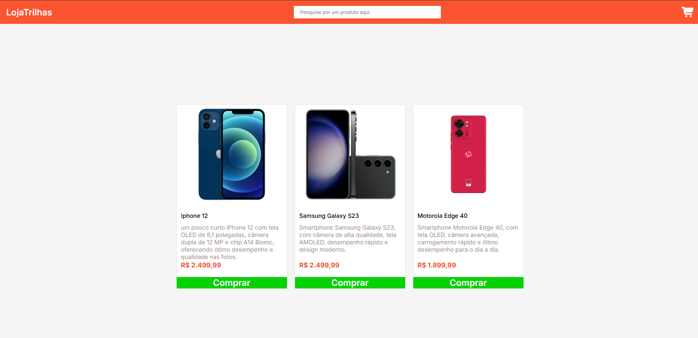

# Loja Trilhas

**Aluno:** Karl Marx  
**Trilha:** Desenvolvimento Mobile  
**Projeto:** Loja Trilhas

## 1. Apresentação

O Loja Trilhas é um projeto de loja virtual desenvolvido para apresentar produtos e seus respectivos preços em uma interface simples e intuitiva.

A loja permite visualizar os produtos disponíveis e consultar seus valores.

## 2. Tecnologias e execução

**Tecnologias utilizadas:**
- HTML5 — estrutura da página.
- CSS3 — estilização e layout.
- JavaScript — implementação das funcionalidades e interações da loja.
- Responsividade mobile — adaptação do layout para dispositivos móveis, como celulares e tablets.

**Funcionalidades JavaScript:**
- Interação com os botões de compra dos produtos.
- Funcionalidades dinâmicas da loja implementadas no arquivo `services.js`.

**Como executar:**

1. Baixe ou clone o repositório do projeto.
2. Abra a pasta do projeto.
3. Execute o arquivo `index.html` em um navegador.

Não é necessário instalar dependências para abrir a página.

## 3. Captura de tela

## 4. Testes realizados

- Abertura da página no navegador.
- Verificação da exibição dos produtos e preços.
- Verificação do layout e da organização dos elementos.
- Verificação das funcionalidades implementadas na página.

## 5. Dificuldade encontrada e aprendizado

Uma das dificuldades encontradas foi organizar os elementos da página para apresentar os produtos de maneira clara e intuitiva.

Com o desenvolvimento do projeto, foi possível praticar os conhecimentos de HTML, CSS e JavaScript, além de compreender melhor a integração entre estrutura, aparência e funcionalidades de uma página web.
